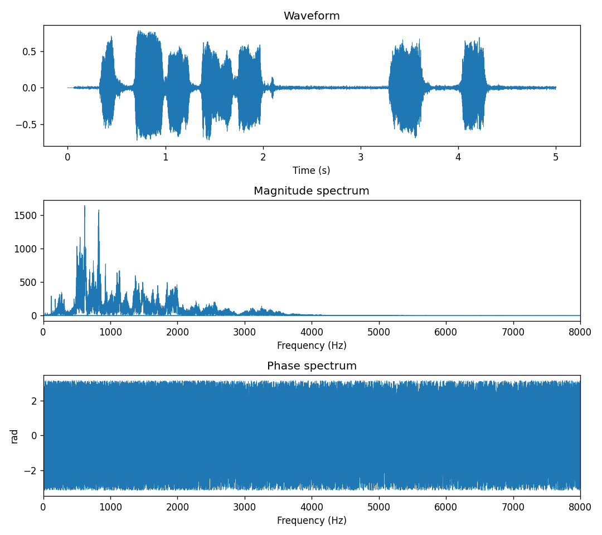
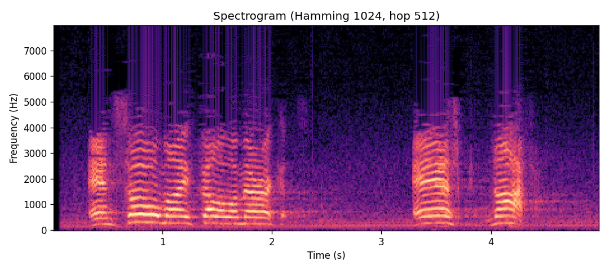
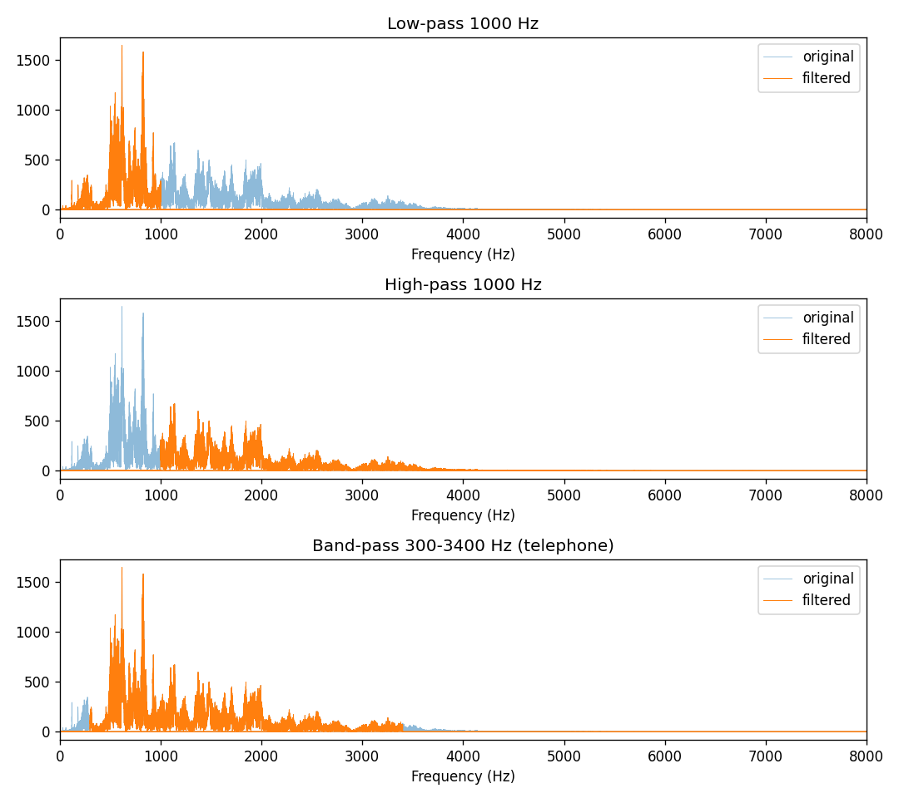
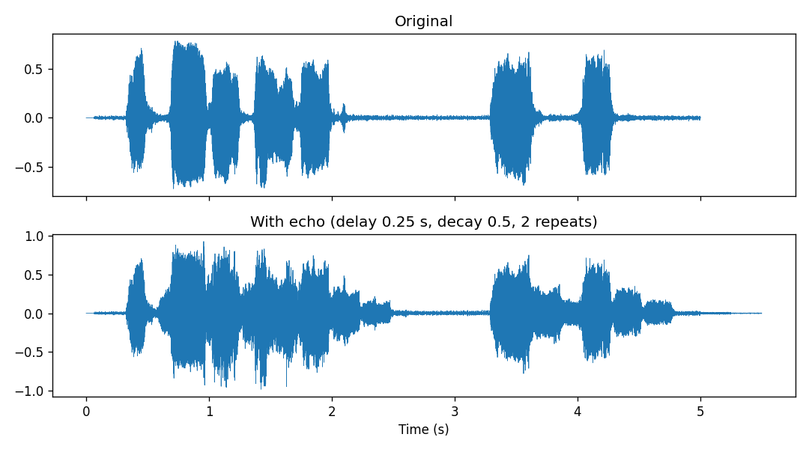
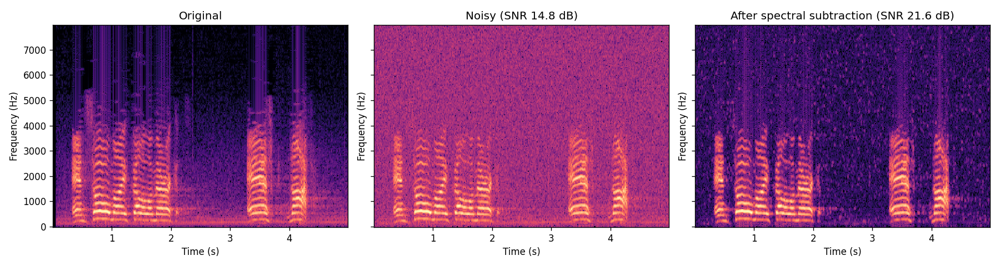

# Speech Signal: Report Section

**Author:** Fatma  |  **Code:** `speech_signal/processing.py`, `core/filters.py`  |  **Tests:** `tests/test_speech.py`, `tests/test_filters.py`

## 1. What this part does

The Speech module lets the user load or record a voice, look at it in the time and frequency domains, and process it. The GUI (by Ghada) only calls the functions below; all signal processing lives in the core.

| Function | What it does |
|---|---|
| `load_audio` / `save_audio` | Read any audio file to a mono array in [-1, 1]; write a 16-bit WAV |
| `record_audio` | Record from the microphone |
| `compute_fft` | One-sided magnitude and phase spectrum |
| `compute_spectrogram` | Short-Time Fourier Transform (STFT), written by hand |
| `filter_audio` | Low-pass, high-pass, band-pass and notch filters |
| `add_echo` | Echo, implemented as a convolution |
| `reduce_noise` | Noise reduction by spectral subtraction |

All of them are built on the project's own `core.fourier` (FFT/IFFT), `core.convolution` and `core.filters`, not on `numpy.fft` or `scipy.signal`. numpy/scipy are used only in the tests, as the reference we compare against.

## 2. Methods

**Spectrum.** The signal is transformed with our FFT and only the non-negative frequencies (0 to fs/2) are kept, because the spectrum of a real signal is symmetric. Magnitude is |X[k]| and phase is the angle of X[k] in radians.

**Spectrogram (STFT).** The signal is cut into frames of N = 1024 samples that advance by a hop of 512. Each frame is multiplied by a Hamming window w[n] = 0.54 − 0.46·cos(2πn/(N−1)), transformed with the FFT, and shown in dB (20·log10|X|). One FFT shows *which* frequencies exist; the spectrogram shows *when* they occur. In the figure below the horizontal bands are the harmonics of the voice and the gaps are the pauses between words.

**Frequency filters.** The filter multiplies the spectrum by a mask H[k] and transforms back: Y[k] = H[k]·X[k]. With `order=None` the mask is an ideal brick wall (exactly 0 or 1). With an integer `order` it is a smooth Butterworth response, H = 1 / (1 + (f/fc)^(2n)), which avoids the "ringing" of the brick wall. The band-pass 300 to 3400 Hz is the classic telephone band: speech stays intelligible even though low and high frequencies are removed. Low-pass and high-pass are exactly complementary, so LPF + HPF with the same cutoff gives back the original (checked in the tests).

**Echo.** An echo is the original sound plus a delayed, weaker copy. This is a convolution with the impulse response h[n] = δ[n] + a·δ[n − D], where D = round(delay·fs) samples and a is the decay. Because D is large (an echo of 0.25 s at 44.1 kHz is 11 025 samples), a direct convolution would be slow, so `add_echo` multiplies the spectra instead (convolution theorem: x * h = IFFT(FFT(x)·FFT(h))), using our own FFT. For short kernels it calls our `convolve1d` directly. Both paths give the same result as `numpy.convolve`. The output is longer than the input so the echo tail is not cut.

**Noise reduction (spectral subtraction).** Stationary background noise has a roughly constant spectrum. The method (1) cuts the signal into overlapping Hamming-windowed frames, (2) estimates the average noise magnitude |N| from the quietest 10 % of frames (or from a noise-only clip chosen by the user), (3) subtracts it from every frame, |Y| = max(|X| − α|N|, β|X|), keeping the original phase, and (4) rebuilds the signal by weighted overlap-add. The floor β·|X| prevents negative values and reduces "musical noise". With α = 0 nothing is removed and the signal is rebuilt perfectly, which we use as a test of the overlap-add.

## 3. Results

Measured on the 5-second real speech recording `assets/speech_sample.wav` (44.1 kHz):

* The strongest frequency is 617 Hz and most of the energy is below 4 kHz, as expected for a voice.
* After a 1000 Hz low-pass, the energy above 1200 Hz is below 0.01 % of the total; the high-pass behaves the same way below 800 Hz.
* Noise reduction: adding white noise gave an SNR of 14.8 dB; after spectral subtraction the SNR was 21.6 dB (an improvement of about 7 dB).
* Processing time on 5 s of audio with our pure-Python FFT: filter about 0.3 s, echo about 0.1 s, noise reduction about 0.2 s, spectrogram about 0.03 s.

## 4. Testing

`tests/test_speech.py` has 50 tests and the whole project suite passes (157 tests). They check:

* **Against numpy/scipy:** FFT vs `np.fft.rfft`, spectrogram frames vs numpy and `scipy.signal.spectrogram`, echo vs `np.convolve`.
* **Known answers:** a 440 Hz tone peaks at 440 Hz; filters keep or remove the right tones; an impulse gives echoes at exactly the right positions and heights; the echo never exceeds 1.0.
* **Real audio:** load, filter, echo, noise reduction, save and reload of a real recording.
* **Edge cases:** missing file, corrupt file, empty audio, stereo input, NaN values, cutoff above the Nyquist frequency, negative delay, no microphone (simulated), signal shorter than one window.

Run them with `python -m pytest tests/test_speech.py -v`.

## 5. Limitations

* The automatic noise estimate needs quiet moments in the recording. For a signal that is equally loud everywhere, the user should provide a noise-only clip (`noise_clip` or `noise_duration`).
* Spectral subtraction assumes the noise is stationary (like a fan or hiss); it will not remove changing sounds such as other voices.
* The ideal brick-wall filter can ring near the cutoff; a Butterworth `order` gives a smoother result.
* Recording could only be tested with a simulated microphone in the automated tests; it should be tried by hand on a real machine.
